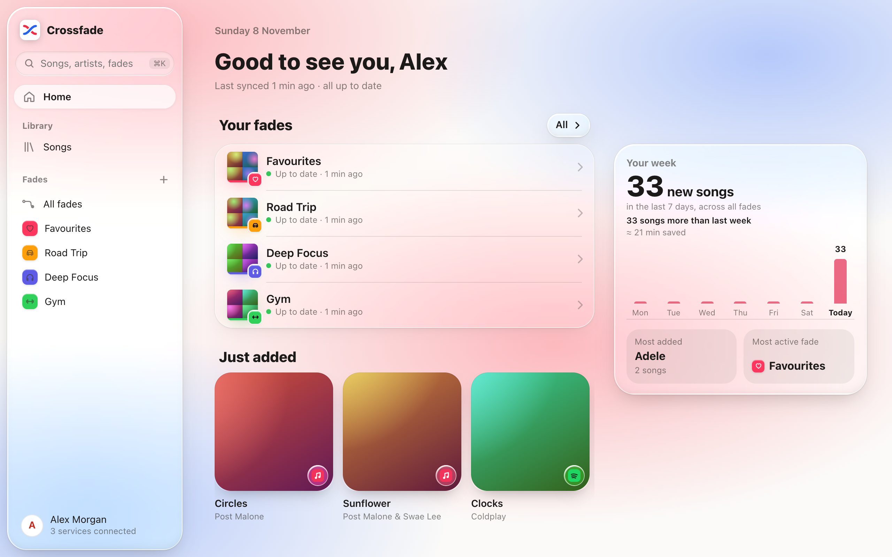
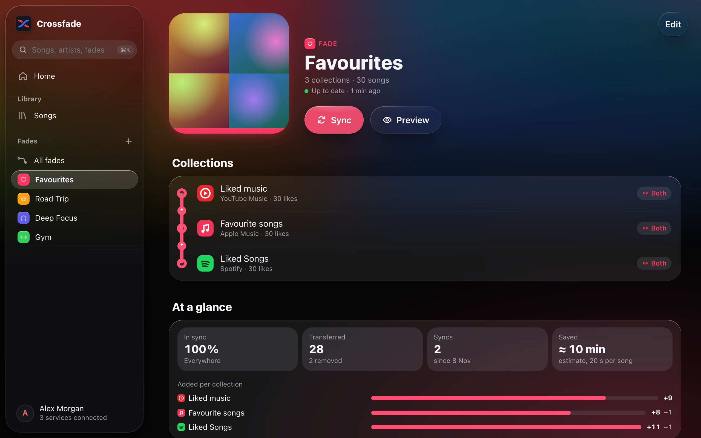
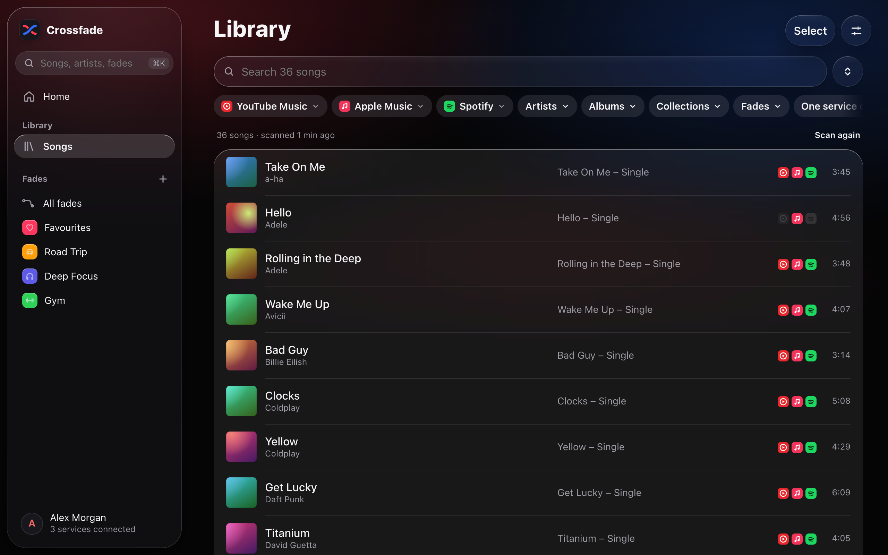
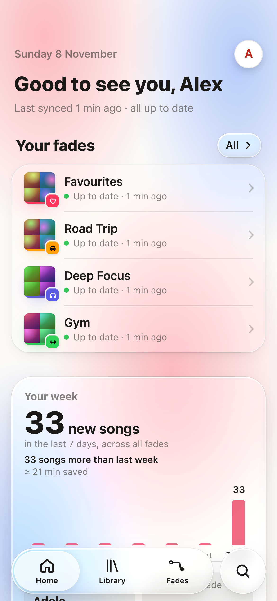

# Crossfade

[](https://github.com/tg099/crossfade/actions/workflows/ci.yml)
[](https://github.com/tg099/crossfade/releases)
[](https://github.com/tg099/crossfade/pkgs/container/crossfade)
[](LICENSE)
[](https://buymeacoffee.com/tg099)

[English](README.md) · **Deutsch**

Selbst gehostete Web-App, die deine Musiksammlungen zwischen Musik-Streamingdiensten synchron hält
([welche das sind](#unterstützte-dienste)): in eine Richtung, in beide Richtungen oder in Gruppen, inklusive Löschungen.
Mehrere Personen teilen sich eine Instanz, jede mit eigenen Diensten und Fades. Nur Admins legen Nutzer an und verwalten sie.

<p align="center">
  
</p>

| Ein Fade | Deine Mediathek | Auf dem Telefon |
|---|---|---|
|  |  |  |

## Begriffe

- **Sammlung**: die Lieblingssongs, die Mediathek oder eine Playlist bei einem Dienst.
- **Fade**: eine Gruppe von Sammlungen, die zusammen synchron gehalten werden. Jede Sammlung im Fade hat eine Rolle:
  - *beide Richtungen*: sendet eigene Änderungen und empfängt die der anderen
  - *sendet*: nur Quelle
  - *empfängt*: nur Ziel; was du dort selbst entfernst, wird nicht wieder hinzugefügt
- Dieselbe Sammlung darf in mehreren Fades stecken; der Editor warnt, wenn sie aus zwei Fades Löschungen empfängt.

| Aufbau | Beispiel |
|---|---|
| In eine Richtung | Playlist „Gym“ bei Dienst A *sendet* → Playlist „Gym“ bei Dienst B *empfängt* |
| In beide Richtungen | Lieblingssongs bei Dienst A ↔ Lieblingssongs bei Dienst B |
| Gruppe | Lieblingssongs bei A ↔ bei B ↔ bei C |

Freunde auf derselben Instanz können einen Fade teilen: Jede Person steuert eine eigene Sammlung bei und sieht
immer nur den Fade selbst, nie die Mediathek der anderen.

## Unterstützte Dienste

| Dienst | Sammlungen | Anmeldung | Schnittstelle |
|---|---|---|---|
| Apple Music | Lieblingssongs, Mediathek, Playlists | Cookie aus dem Web-Player | Inoffiziell (die des Web-Players) |
| Spotify | Lieblingssongs, Playlists | Spotify-Login; der Admin registriert einmalig eine App | Offizielle Web API |
| YouTube Music | Lieblingsmusik, Mediathek-Songs, Playlists | Request aus dem Browser kopieren oder Google-Code (dann nur Lieblingsvideos und Playlists) | Inoffiziell (die der Web-App); mit Google-Code die offizielle YouTube Data API |

Wie du die einzelnen Dienste verbindest, steht unter [Dienste einrichten](#dienste-einrichten). Ein neuer Dienst
ist ein Modul in `crossfade/providers/`; Wünsche gern als [Issue](https://github.com/tg099/crossfade/issues).

## Betrieb mit Docker (empfohlen)

Voraussetzungen: ein Server mit Docker und eine Domain, deren DNS auf ihn zeigt (Ports 80/443 offen).

```sh
curl -O https://raw.githubusercontent.com/tg099/crossfade/main/docker-compose.yml \
     -O https://raw.githubusercontent.com/tg099/crossfade/main/Caddyfile \
     -o .env https://raw.githubusercontent.com/tg099/crossfade/main/.env.example
python3 -c "import secrets; print(secrets.token_urlsafe(48))"   # → CROSSFADE_SECRET_KEY in .env
# CROSSFADE_DOMAIN in .env setzen
docker compose up -d
```

Dann `https://<deine-domain>` öffnen und das Admin-Konto anlegen. Caddy besorgt das HTTPS-Zertifikat selbst.

- Images: `ghcr.io/tg099/crossfade` für `linux/amd64` und `linux/arm64`. Tags: `latest`, `X.Y` (nur Fehlerbehebungen),
  `X.Y.Z` und `testing` (neuestes Release inklusive Vorabversionen). Ein neues Image entsteht bei jedem [GitHub-Release](https://github.com/tg099/crossfade/releases).
- Daten (SQLite, verschlüsselte Logins) liegen im Volume `crossfade-data`, also regelmäßig sichern. Crossfade hebt
  außerdem die letzten 10 Datenbank-Stände in `backups/` auf (einer pro Start).
- **`CROSSFADE_SECRET_KEY` nie ändern**, sonst lassen sich gespeicherte Logins nicht mehr entschlüsseln.
- Läuft schon ein Reverse Proxy (Traefik, Nginx Proxy Manager …)? Nur den Dienst `crossfade` starten, auf Port 8765
  weiterleiten, `CROSSFADE_BASE_URL=https://…` setzen und die Pufferung für `/api/events` abschalten (Server-Sent Events).
  Weitergeleiteten Headern (`X-Forwarded-For`/`-Proto`) wird nur aus privaten Netzen vertraut; erreichen andere
  Geräte im LAN Port 8765 direkt, setz `FORWARDED_ALLOW_IPS` auf die Adresse deines Proxys.
- Unraid: siehe [docs/unraid.md](docs/unraid.md) (Englisch).
- Selbst bauen: in `docker-compose.yml` die Zeile `build: .` aktivieren und `docker compose up -d --build`.

## Dienste einrichten

Jede Person verbindet ihre eigenen Konten in der App (**Konto → Dienste**); die App führt durch die Schritte.
Manche Dienste brauchen vorher eine einmalige Einrichtung durch den Admin.

### Spotify (einmalig, Admin)

1. [Spotify Developer Dashboard](https://developer.spotify.com/dashboard) → App anlegen (Web API).
2. Redirect URI: `https://<deine-domain>/api/services/spotify/callback`
3. Unter *User Management* die Spotify-Konten aller Nutzer eintragen.
4. Client ID in Crossfade unter **Konto → App-Zugänge** eintragen (oder `SPOTIFY_CLIENT_ID` setzen).

Einschränkungen von Spotify für Apps im Entwicklungsmodus (seit 2026): Konten brauchen **Premium**, höchstens **5 Nutzer** pro App.

### YouTube Music

- **Über den Browser** (funktioniert immer): auf music.youtube.com bei einem Request „Als cURL kopieren“ und einfügen.
  Die App zeigt die Schritte.
- **Mit Google-Code** (optional): Google-Cloud-Projekt mit der YouTube Data API v3 und einem OAuth-Client vom Typ
  „Fernseher und Geräte mit begrenzter Eingabe“ anlegen, dann Client ID/Secret unter **Konto → App-Zugänge** eintragen.
  Google lehnt diesen Weg bei YouTube Music zeitweise ab; der Browser-Weg funktioniert dann trotzdem.

### Apple Music

Cookie `media-user-token` von music.apple.com kopieren und einfügen. Kein Apple-Developer-Account nötig;
die App nutzt dieselbe Schnittstelle wie der Web-Player von Apple.

## Wie synchronisiert wird

Jeder Fade merkt sich, welche Songs er kennt und wo er sie zuletzt gesehen hat.

1. Alle Sammlungen werden gelesen; Songs werden dienstübergreifend als derselbe Song erkannt
   (ISRC, Titel, Interpret, Dauer).
2. Neu in einer sendenden Sammlung → wird zu allen empfangenden hinzugefügt
   (Suche im Katalog des Ziels, Ergebnisse werden zwischengespeichert).
3. Aus einer sendenden Sammlung verschwunden, in der er vorher gesehen wurde → wird überall entfernt
   (wenn *Löschungen übertragen* an ist).
4. Unsichere Treffer landen als **offene Songs** im Fade: Vorschlag wählen, Link einfügen oder ignorieren.

### Schutzmechanismen

- Der **erste Sync** führt nur zusammen, er löscht nie.
- Gelöscht werden nur Songs, die vorher in einer Sammlung **gesehen** wurden. Ein gerade hinzugefügter Song, den
  der Dienst noch nicht anzeigt, gilt als „ausstehend“, nicht als gelöscht.
- Eine **leere Liste** von einem Dienst, obwohl dort Songs bekannt sind → der Sync bricht ab.
- **Sicherheitsgrenze** pro Fade: mehr Löschungen als erlaubt → wartet auf Bestätigung. Automatische Syncs bestätigen nie.
- Fehlgeschlagene Löschungen werden beim nächsten Sync erneut versucht, statt rückgängig gemacht zu werden.
- Die **Vorschau** zeigt jeden Sync, ohne etwas zu ändern.

## Sicherheit

- Logins bei den Diensten werden verschlüsselt gespeichert, mit einem Schlüssel aus `CROSSFADE_SECRET_KEY`.
- Passwörter mit scrypt gehasht, Sitzungen als HttpOnly-Cookies (über HTTPS mit Secure), CSRF-Schutz über einen
  Pflicht-Header, strenge Content Security Policy, Begrenzung der Anmeldeversuche.
- Keine Selbstregistrierung: Nur Admins legen Nutzer an. Neue Nutzer bekommen ein Startpasswort und wählen beim
  ersten Anmelden ein eigenes.

Sicherheitslücke gefunden? Bitte [privat melden](https://github.com/tg099/crossfade/security/advisories/new),
nicht als öffentliches Issue.

## Entwicklung

```sh
python3.12 -m venv .venv && .venv/bin/pip install -r requirements-dev.txt
.venv/bin/python -m pytest -q                 # Tests für Engine und API
cd web && npm install && npm run dev          # Frontend mit Proxy auf :8765
.venv/bin/uvicorn crossfade.api.app:app --port 8765 --reload
```

Lokal ohne Docker: `./start.sh` (baut das Frontend bei Bedarf und läuft unter http://127.0.0.1:8765).

Bitte Syncs nicht gegen deine echten Konten testen: nimm ein eigenes `CROSSFADE_DATA_DIR` mit Testdaten.

| Pfad | Inhalt |
|---|---|
| `crossfade/engine.py` | Sync-Logik eines Fades |
| `crossfade/identity.py` | Song-Identität über Dienste hinweg, Katalogsuche |
| `crossfade/matcher.py` | Abgleich nach Titel, Interpret, Dauer, ISRC |
| `crossfade/providers/` | Ein Modul pro [unterstütztem Dienst](#unterstützte-dienste) |
| `crossfade/worker.py` | Zeitplan, Hintergrund-Syncs, Live-Fortschritt |
| `crossfade/api/` | HTTP-API, Anmeldung, Nutzerverwaltung |
| `web/` | Oberfläche (SvelteKit, statisch gebaut) |

Umgebungsvariablen: siehe `.env.example`. Zusätzlich `CROSSFADE_DATA_DIR`, `CROSSFADE_BASE_URL`,
`CROSSFADE_WEB_DIR`, `CROSSFADE_SECURE_COOKIES` und `CROSSFADE_SOURCE_URL`.

Die Oberfläche nutzt ein Liquid-Glass-Design für Telefon und Desktop, mit Hell/Dunkel/System und Deutsch und Englisch
(Texte in `web/src/lib/ui/lang/`, beide Dateien haben dieselben Schlüssel).

### Releases

Die Version steht nur im Release-Tag; im Code gibt es nichts hochzuzählen.

1. GitHub → *Releases* → *Draft a new release* → neuer Tag `vX.Y.Z` auf `main` → *Generate release notes*
   (gruppiert nach PR-Labels: `breaking`, `enhancement`, `bug`, `security`, `dependencies`) → *Publish*.
2. Der Workflow *Release image* führt die Tests aus, baut das Image, startet es einmal als Smoke-Test, prüft es
   auf kritische Sicherheitslücken und pusht erst dann `X.Y.Z`, `X.Y`, `latest` und `testing` für amd64 und arm64
   (Vorabversionen, Tag `vX.Y.Z-rc.N` + *Set as a pre-release*, bekommen nur `X.Y.Z-…` und `testing`), mit SBOM und signierter Build-Provenienz.

Image prüfen: `gh attestation verify oci://ghcr.io/tg099/crossfade:X.Y.Z -R tg099/crossfade`.

## Mitmachen

Fehler und Ideen gern als [Issue](https://github.com/tg099/crossfade/issues), Fragen in den
[Discussions](https://github.com/tg099/crossfade/discussions). Pull Requests werden per Squash gemergt.

## Projekt unterstützen

Wenn dir Crossfade hilft, kannst du mir gern [einen Kaffee spendieren](https://buymeacoffee.com/tg099). Danke!

## Haftungsausschluss

Crossfade steht in keiner Verbindung zu den unterstützten Diensten oder den Unternehmen dahinter. Dienste, die in der
[Liste](#unterstützte-dienste) als *inoffiziell* markiert sind, werden über ihre Web-Schnittstellen angesprochen, die
sich jederzeit ändern können. Die Nutzung erfolgt auf eigenes Risiko und im Rahmen der Bedingungen des jeweiligen Dienstes.

## Lizenz

[PolyForm Strict License 1.0.0](LICENSE).
