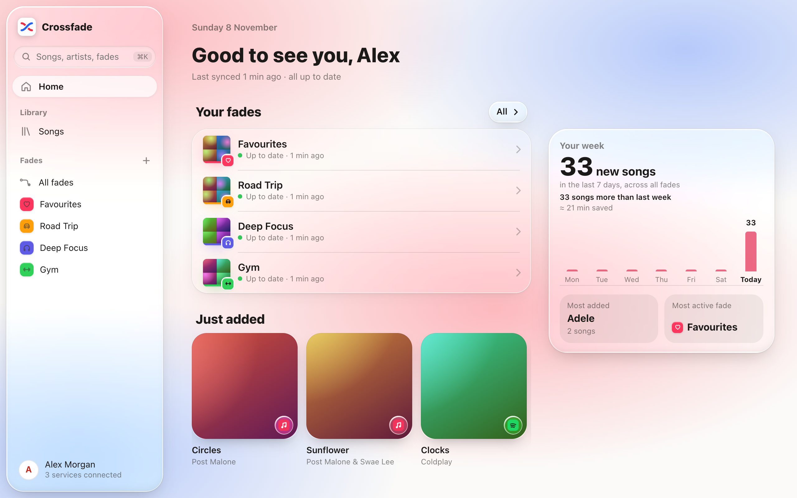
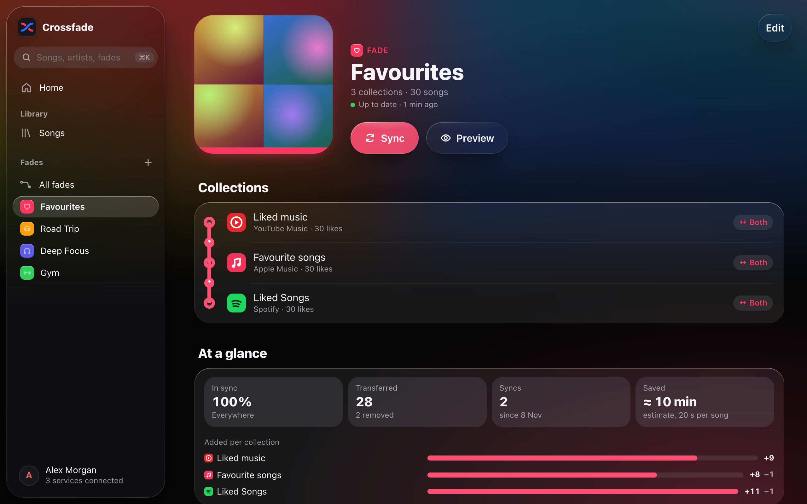
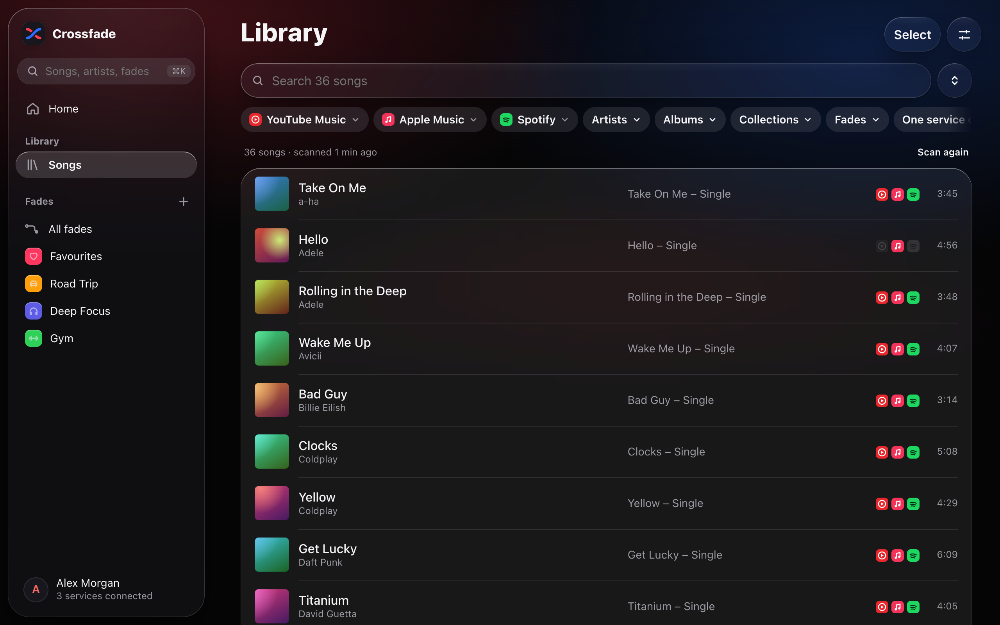
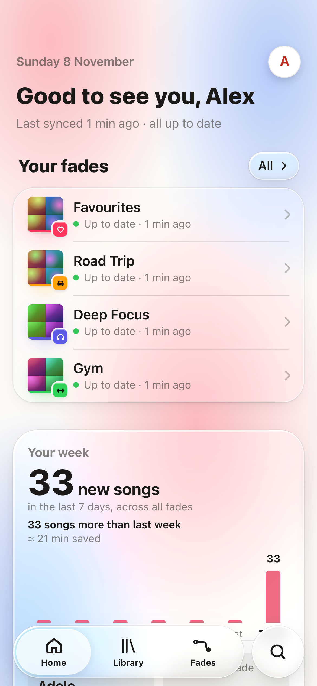

# Crossfade

[](https://github.com/tg099/crossfade/actions/workflows/ci.yml)
[](https://github.com/tg099/crossfade/releases)
[](https://github.com/tg099/crossfade/pkgs/container/crossfade)
[](LICENSE)
[](https://buymeacoffee.com/tg099)

**English** · [Deutsch](README.de.md)

A self-hosted web app that keeps your music collections in sync across music streaming services
([see which ones](#supported-services)): one way, both ways or in groups, including deletions.
Several people share one instance, each with their own services and fades. Only admins create and manage users.

<p align="center"><a href="https://buymeacoffee.com/tg099"></a></p>

<p align="center">
  
</p>

| A fade | Your library | On the phone |
|---|---|---|
|  |  |  |

## Concepts

- **Collection**: the liked songs, the library or a playlist on one service.
- **Fade**: a group of collections that are kept in sync. Each collection in a fade has a role:
  - *both directions*: sends its own changes and receives the others'
  - *sends*: source only
  - *receives*: target only; anything you remove there yourself is not added again
- The same collection can be part of several fades; the editor warns if it receives deletions from two fades.

| Setup | Example |
|---|---|
| One-way | Playlist "Gym" on service A *sends* → playlist "Gym" on service B *receives* |
| Bidirectional | Liked songs on service A ↔ liked songs on service B |
| Group | Liked songs on A ↔ on B ↔ on C |

Friends on the same instance can share a fade: each person adds one of their own collections and only ever sees
the fade itself, never the other person's library.

## Supported services

| Service | Collections | Sign-in | Interface |
|---|---|---|---|
| Apple Music | Favourite songs, library, playlists | Cookie from the web player | Unofficial (the web player's) |
| Spotify | Liked songs, playlists | Spotify login; the admin registers an app once | Official Web API |
| YouTube Music | Liked music, library songs, playlists | Request copied from the browser, or a Google code (then liked videos and playlists only) | Unofficial (the web app's); official YouTube Data API with a Google code |
| TIDAL | My Tracks, playlists | TIDAL login; the admin registers an app once | Official TIDAL API |
| Deezer | Favourite tracks, playlists | Cookie from the web player | Unofficial (the web player's); catalogue through the public API |

How to connect each one is in [Setting up the services](#setting-up-the-services). A new service is one module in
`crossfade/providers/`; requests are welcome as [issues](https://github.com/tg099/crossfade/issues).

## Installation

Crossfade is one Docker image (`ghcr.io/tg099/crossfade`, amd64 and arm64) with no database server or other
dependencies. **Step-by-step guide: [docs/install.md](docs/install.md)**, with these setups:

| You have … | Setup |
|---|---|
| A server with a domain | [Docker Compose with automatic HTTPS](docs/install.md#a-docker-compose-with-automatic-https) (Caddy included) |
| A reverse proxy already (Nginx Proxy Manager, Traefik …) | [Behind your existing reverse proxy](docs/install.md#b-behind-your-existing-reverse-proxy) |
| Just want to try it | [Quick start with `docker run`](docs/install.md#c-quick-start-with-docker-run) |
| An Unraid server | [docs/unraid.md](docs/unraid.md) |

The short version, on a server whose domain points to it (ports 80/443 open):

```sh
mkdir crossfade && cd crossfade
curl -O https://raw.githubusercontent.com/tg099/crossfade/main/docker-compose.yml \
     -O https://raw.githubusercontent.com/tg099/crossfade/main/Caddyfile \
     -o .env https://raw.githubusercontent.com/tg099/crossfade/main/.env.example
openssl rand -base64 48        # → CROSSFADE_SECRET_KEY in .env, also set CROSSFADE_DOMAIN
docker compose up -d
```

Then open `https://<your-domain>` and create the admin account. **Never change `CROSSFADE_SECRET_KEY`** afterwards,
or stored logins can no longer be decrypted. Updating: `docker compose pull && docker compose up -d`.
[Updating, tags, backups and troubleshooting](docs/install.md#updating) are in the guide.

To try it on your own computer: `docker run -d -p 8765:8765 -v crossfade-data:/data ghcr.io/tg099/crossfade`,
then open <http://localhost:8765>.

Build from source: uncomment `build: .` in `docker-compose.yml` and run `docker compose up -d --build`.

## Setting up the services

Each person connects their own accounts in the app (**Account → Services**); the app walks through the steps.
Some services need a one-time setup by the admin first.

### Spotify (once, admin)

1. [Spotify Developer Dashboard](https://developer.spotify.com/dashboard) → create an app (Web API).
2. Redirect URI: `https://<your-domain>/api/services/spotify/callback`
3. Under *User Management*, add the Spotify accounts of all users.
4. Enter the client ID in Crossfade under **Account → App credentials** (or set `SPOTIFY_CLIENT_ID`).

Spotify's limits for apps in development mode (since 2026): accounts need **Premium**, at most **5 users** per app.

### YouTube Music

- **Via the browser** (always works): on music.youtube.com, "Copy as cURL" on a request and paste it.
  The app shows the steps.
- **With a Google code** (optional): create a Google Cloud project with the YouTube Data API v3 and an OAuth
  client of type "TVs and Limited Input devices", then enter client ID/secret under **Account → App credentials**.
  Google sometimes rejects this flow for YouTube Music; the browser method still works then.

### Apple Music

Copy the `media-user-token` cookie from music.apple.com and paste it. No Apple developer account needed;
the app uses the same interface as Apple's web player.

### TIDAL (once, admin)

1. [TIDAL Developer Dashboard](https://developer.tidal.com/dashboard) → create an app.
2. Redirect URI: `https://<your-domain>/api/services/tidal/callback`
3. Enable the scopes `user.read`, `collection.read`, `collection.write`, `playlists.read`, `playlists.write` and `search.read`.
4. Enter the client ID (and secret) in Crossfade under **Account → App credentials** (or set `TIDAL_CLIENT_ID`/`TIDAL_CLIENT_SECRET`).
   With the secret, Crossfade can also search TIDAL's catalogue for users without a TIDAL account.

TIDAL gives third-party apps no samples, so TIDAL versions can't be listened to in Crossfade.

### Deezer

Copy the `arl` cookie from deezer.com and paste it. Deezer no longer accepts new developer apps, so this goes
through the web player's interface; search and samples come from Deezer's public API. The cookie usually lasts a
few months and stops working when you sign out of Deezer.

## How syncing works

Each fade remembers which songs it knows and where it last saw them.

1. All collections are read; songs are recognised as the same song across services
   (ISRC, title, artist, duration).
2. New in a sending collection → added to all receiving ones
   (searched in the target's catalogue, results are cached).
3. Gone from a sending collection where it was seen before → removed everywhere
   (if *Pass on deletions* is on).
4. Uncertain matches end up as **open songs** in the fade: pick a suggestion, paste a link or ignore them.

### Safeguards

- The **first sync** only merges, it never deletes.
- Only songs that were previously **seen** in a collection can be deleted. A song that was just added but isn't
  shown by the service yet counts as "pending", not as deleted.
- An **empty list** from a service although songs are known there → the sync stops.
- **Safety limit** per fade: more deletions than allowed → waits for confirmation. Automatic syncs never confirm.
- Failed deletions are retried on the next sync instead of being reverted.
- **Preview** shows every sync without changing anything.

## Beyond syncing

- **AI assistants and mood playlists** (**Account → AI assistants**): a built-in MCP server lets your
  assistant search and compare your library, prepare playlists for freely described moods, manage fades,
  resolve matches, tidy duplicates and use time travel. Personal tokens have read/sync/manage permissions;
  the assistant carries out changes itself, only deletions wait for your confirmation in Crossfade (with a
  link, a home-page card and an optional notification). Mood/genre estimates come from the connected assistant,
  with confidence and protected personal corrections. [Setup, tools and limitations](docs/mcp.md).
- **Time travel:** every time Crossfade reads a whole collection it remembers its content, only when something
  changed. In the library (clock icon) or on a collection in a fade you pick a point in time, see what is gone and
  what came in since, and bring back single songs or reset the collection to exactly that state. The last 7 days
  are kept in full, then one state per day for 90 days.
- **Notifications** (**Account → Notifications**): through [ntfy](https://ntfy.sh), a webhook (Discord and Slack are
  recognised, otherwise JSON, e.g. for Home Assistant) or e-mail through an SMTP server the admin adds under
  **App credentials**. Per channel: a login stops working or ends soon, a sync is waiting for you, new open songs,
  syncs that keep failing, friends, and for admins a new release. Each problem is reported only once, in the
  person's language (their setting, else their browser's).
- **Login checks:** Crossfade tries every login twice a day, also those no fade uses, and remembers when it ends if
  the service says so (e.g. after 7 days for Google apps in testing mode).
- **Health** (admins only, **Account → Health**): requests, errors, throttling and duration per service and hour,
  syncs of the last 24 hours, database, backups, free storage and the latest errors. Counts only, nothing private.
- **Backups** (admins only, **Account → Backups**): Crossfade backs up its database on every start and once a day.
  Make one by hand, download it, or restore one (also from a downloaded file, e.g. when moving to a new server).
  Before a restore the current state is backed up too. The secret key is never part of a backup: keep it separately.
- **Update hint** (admins only): twice a day Crossfade looks at the GitHub releases and shows a new version on the
  home page and under **Account**. Development builds never look; `CROSSFADE_UPDATE_CHECK=false` turns it off.
- **First steps:** new users get a checklist on the home page (connect services, first fade, first sync,
  notifications) until everything is set up or they hide it.

## Security

- Service logins are stored encrypted with a key derived from `CROSSFADE_SECRET_KEY`.
- Passwords hashed with scrypt, sessions as HttpOnly cookies (Secure over HTTPS), CSRF protection via a required
  header, strict Content Security Policy, login rate limiting.
- No self-registration: only admins create users. New users get a start password and must choose their own at
  first sign-in.

Found a vulnerability? Please [report it privately](https://github.com/tg099/crossfade/security/advisories/new),
not as a public issue.

## Development

```sh
python3.12 -m venv .venv && .venv/bin/pip install -r requirements-dev.txt
.venv/bin/python -m pytest -q                 # engine and API tests
cd web && npm install && npm run dev          # frontend with proxy to :8765
.venv/bin/uvicorn crossfade.api.app:app --port 8765 --reload
```

Locally without Docker: `./start.sh` (builds the frontend if needed and serves http://127.0.0.1:8765).

Please don't test syncs against your real accounts: use a scratch `CROSSFADE_DATA_DIR` with test data.

| Path | Contents |
|---|---|
| `crossfade/engine.py` | Sync logic of a fade |
| `crossfade/identity.py` | Song identity across services, catalogue search |
| `crossfade/matcher.py` | Matching by title, artist, duration, ISRC |
| `crossfade/providers/` | One module per [supported service](#supported-services) |
| `crossfade/worker.py` | Schedule, background syncs, live progress |
| `crossfade/api/` | HTTP API, sign-in, user management |
| `web/` | UI (SvelteKit, static build) |

Environment variables: see `.env.example`. Additionally `CROSSFADE_DATA_DIR`, `CROSSFADE_BASE_URL`,
`CROSSFADE_WEB_DIR` and `CROSSFADE_SECURE_COOKIES`.

The UI uses a Liquid Glass design for phone and desktop, with light/dark/system themes and German and English
(texts in `web/src/lib/ui/lang/`, both files share the same keys).

### Releasing

The release tag is the only place the version lives; there is nothing to bump in the code.

1. GitHub → *Releases* → *Draft a new release* → new tag `vX.Y.Z` on `main` → *Generate release notes*
   (grouped by PR labels: `breaking`, `enhancement`, `bug`, `security`, `dependencies`) → *Publish*.
2. The *Release image* workflow runs the tests, builds the image, starts it once as a smoke test, scans it
   for critical vulnerabilities and only then pushes `X.Y.Z`, `X.Y`, `latest` and `testing` for amd64 and arm64
   (pre-releases, tag `vX.Y.Z-rc.N` + *Set as a pre-release*, only get `X.Y.Z-…` and `testing`), with SBOM and signed build provenance.

Verify an image: `gh attestation verify oci://ghcr.io/tg099/crossfade:X.Y.Z -R tg099/crossfade`.

## Contributing

Bugs and feature ideas are welcome as [issues](https://github.com/tg099/crossfade/issues), questions in
[Discussions](https://github.com/tg099/crossfade/discussions). Pull requests are squash-merged; by opening one you agree to the contribution terms in the [license](LICENSE).

## Support the project

Crossfade is free, source available and built in my spare time. If it keeps your music in sync, a coffee helps
keep it going. Thank you! ☕

<a href="https://buymeacoffee.com/tg099"></a>

## Disclaimer

Crossfade is not affiliated with any of the supported services or the companies behind them. Services marked
*unofficial* in the [list](#supported-services) are accessed through their web interfaces, which can change at any
time; use Crossfade at your own risk and in line with each service's terms.

## License

[PolyForm Strict License 1.0.0](LICENSE) with additional permissions. In short:

- You may use Crossfade for free for yourself and host it for friends and family, free of charge.
- No commercial use, no selling it or access to it, no redistribution and no changed versions or forks of your own.
- Changes are only allowed to propose them here as a pull request.
